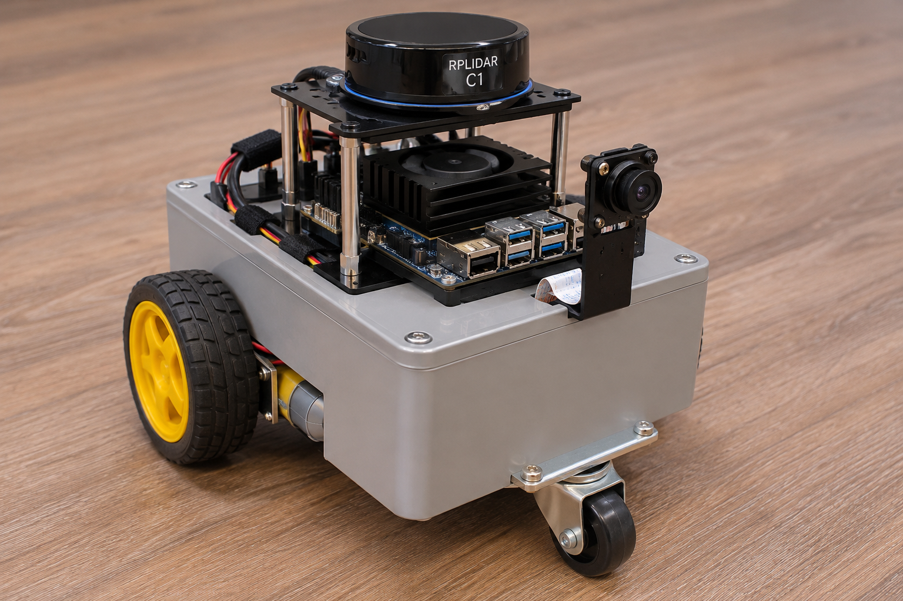

# Robotics

ROS 2 robotics projects, embedded firmware, and experiments.

## Table of Contents

- [Repository layout](#repository-layout)
- [Projects](#projects)
  - [Differential-drive robot](#differential-drive-robot)
    - [Planned physical robot](#planned-physical-robot)
    - [Gazebo apartment simulation](#gazebo-apartment-simulation)
    - [RViz map visualization](#rviz-map-visualization)
  - [Differential-drive ESP32 firmware](#differential-drive-esp32-firmware)
  - [Toy robot](#toy-robot)
- [Toy Robot Quick Start](#toy-robot-quick-start)
- [Requirements](#requirements)
- [Documentation](#documentation)

## Repository layout

This repository is organized as a multi-project workspace:

```text
Robotics/
├── README.md
├── docs/
│   ├── differential_drive_ws/
│   └── toy_robot_ws/
├── images/
├── projects/
│   ├── differential_drive_esp32/
│   ├── differential_drive_ws/
│   ├── differential_drive_gazebo_baseline_ws/
│   ├── differential_drive_gazebo_ros2_control_baseline_ws/
│   └── toy_robot_ws/
└── .gitignore
```

Each ROS workspace keeps its own source packages and generated build, install, and log directories. ESP32 firmware is maintained separately as a PlatformIO project.

## Projects

### Differential-drive robot

[projects/differential_drive_ws/](projects/differential_drive_ws/) — differential-drive simulation, SLAM, localization, and Nav2 navigation with ROS 2 Jazzy and Gazebo Harmonic.

- `differential_drive_robot`: robot model, sensors, ros2_control configuration, EKF, worlds, maps, and RViz settings.
- `differential_drive_bringup`: XML launch files and Nav2 configuration for mapping and localization/navigation.
- The apartment world contains a bedroom and open living/dining area, with an SUV outside.
- Simulation currently uses Gazebo's ros2_control backend; physical hardware integration is not yet implemented.

See the [Differential Drive SLAM Runbook](docs/differential_drive_ws/differential_drive_slam_runbook.md) for environment setup, mapping, map saving, localization, and navigation commands.

#### Planned physical robot



Concept illustration; dimensions and component placement are provisional, not a validated assembly. The planned robot pairs a Jetson Orin Nano Super running ROS 2 with an ESP32 for low-level I/O and a Cytron MDD10A motor driver.

See the [hardware plan](docs/differential_drive_ws/HARDWARE.md) for components, power, and physical layout, and the [ESP32 + MDD10A hardware guide](docs/differential_drive_ws/ESP32_MDD10A_HARDWARE_GUIDE.md) for USB/serial bring-up and the proposed wiring.

#### Gazebo apartment simulation


#### RViz map visualization


### Differential-drive ESP32 firmware

[projects/differential_drive_esp32/](projects/differential_drive_esp32/) — PlatformIO project for the physical differential-drive robot's ESP32-WROOM-32E board, using the Arduino framework and the `esp32dev` environment.

- Current firmware is a USB/serial bring-up test that prints a startup message and a status message every 10 seconds at 115200 baud.
- Motor control, encoder acquisition, IMU integration, and the ROS 2 hardware interface are not yet implemented.

See the [ESP32 + MDD10A hardware guide](docs/differential_drive_ws/ESP32_MDD10A_HARDWARE_GUIDE.md) for the development workflow and low-level control plan.

### Toy robot

- [projects/toy_robot_ws/](projects/toy_robot_ws/) — ROS 2 workspace for the toy robot project
  - `toy_robot_description`: modular URDF/xacro robot model, Gazebo world, and launch files
  - `toy_robot_interfaces`: custom ROS 2 interfaces for runtime nodes
  - `toy_robot`: runtime behavior, perception, navigation, and visualization stack

See [projects/toy_robot_ws/README.md](projects/toy_robot_ws/README.md) for project-specific build and launch instructions.

## Toy Robot Quick Start

```bash
cd ~/Robotics/projects/toy_robot_ws
source /opt/ros/jazzy/setup.bash
colcon build --symlink-install
source install/setup.bash
ros2 launch toy_robot robot.launch.xml
```

URDF-only visualization:

```bash
cd ~/Robotics/projects/toy_robot_ws
source /opt/ros/jazzy/setup.bash
colcon build --packages-select toy_robot_description
source install/setup.bash
ros2 launch toy_robot_description display.launch.xml
```

## Requirements

- ROS 2 Jazzy
- Gazebo Harmonic, ros_gz, ros2_control, gz_ros2_control, robot_localization, SLAM Toolbox, and Nav2 for the differential-drive workspace
- xacro, robot_state_publisher, joint_state_publisher_gui, rviz2
- nav2 (for the full toy_robot launch flow)
- PlatformIO with the Espressif32 platform and Arduino framework for the ESP32 firmware project; ROS 2 is not required to build this firmware

## Documentation

- [Differential Drive SLAM Runbook](docs/differential_drive_ws/differential_drive_slam_runbook.md) — differential-drive simulation, mapping, localization, and navigation
- [Differential Drive Hardware Plan](docs/differential_drive_ws/HARDWARE.md) — planned components, power, physical layout, and bring-up order
- [ESP32 + MDD10A Hardware Guide](docs/differential_drive_ws/ESP32_MDD10A_HARDWARE_GUIDE.md) — ESP32 USB/serial bring-up, firmware workflow, and proposed low-level wiring
- [Toy Robot Architecture](docs/toy_robot_ws/toy_robots-architecture.odt) — architecture document
- [projects/toy_robot_ws/docs/index.md](projects/toy_robot_ws/docs/index.md) — documentation entry point
- [projects/toy_robot_ws/docs/development.md](projects/toy_robot_ws/docs/development.md) — build, launch, and test workflow
- [projects/toy_robot_ws/docs/architecture.md](projects/toy_robot_ws/docs/architecture.md) — runtime architecture and data flow
- [projects/toy_robot_ws/docs/rviz_debug.md](projects/toy_robot_ws/docs/rviz_debug.md) — marker semantics and troubleshooting
- [projects/toy_robot_ws/src/toy_robot_description/urdf/README.md](projects/toy_robot_ws/src/toy_robot_description/urdf/README.md) — URDF/xacro modularization and dimension dependencies
