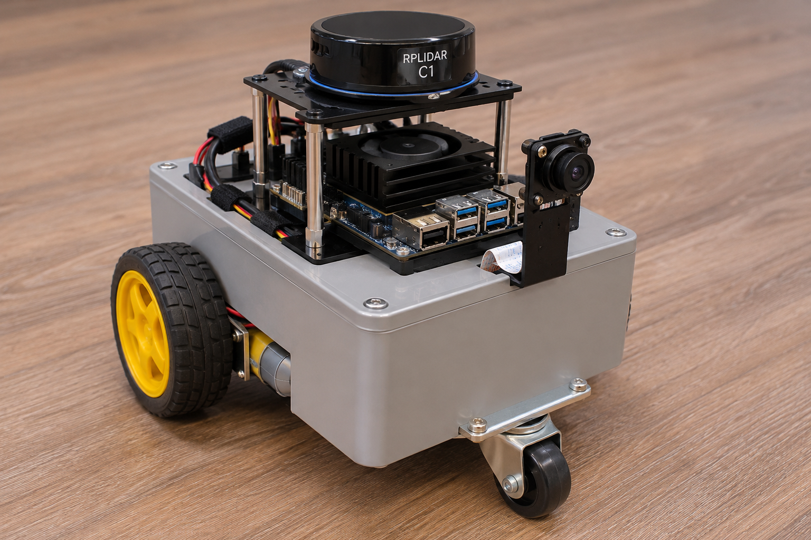
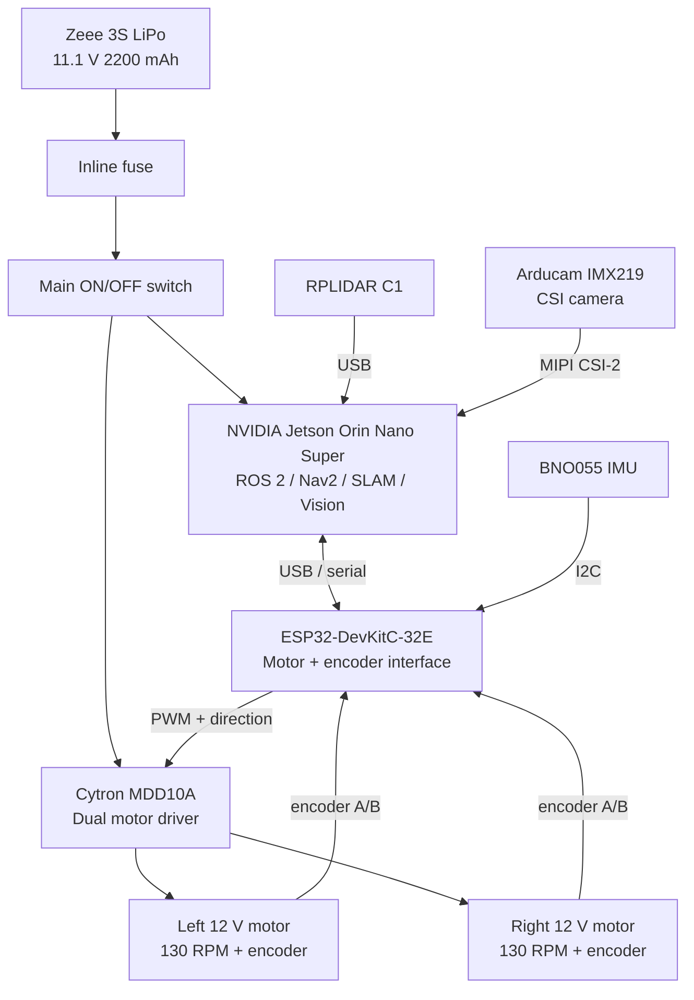

# Differential Drive Robot Hardware

Planned hardware for a compact two-wheel differential-drive robot built around an **NVIDIA
Jetson Orin Nano Super**. An **ESP32-DevKitC-32E** handles the real-time
motor and encoder interface, while the Jetson runs ROS 2,
`ros2_control`, localization, SLAM, Nav2, and vision workloads.

The proposed physical design uses a **165 × 120 × 68 mm uxcell enclosure** as the
chassis, two **65 mm wheels with encoder-equipped motors**, and a **1-inch swivel caster**.

> **Design status:** This is a hardware plan, not a validated assembly or an
> implemented hardware driver. Product specifications, electrical compatibility,
> mechanical fit, and loaded performance must be checked before assembly.

## Table of Contents

- [Hardware Concept](#hardware-concept)
- [Hardware Architecture](#hardware-architecture)
- [Components](#components)
- [Power](#power)
  - [Power Checks Before Connection](#power-checks-before-connection)
- [Drive System](#drive-system)
- [Sensors](#sensors)
  - [RPLIDAR C1](#rplidar-c1)
  - [BNO055](#bno055)
  - [Arducam IMX219](#arducam-imx219)
- [ROS 2 Data Flow](#ros-2-data-flow)
- [Physical Layout](#physical-layout)
  - [Simulation Appearance](#simulation-appearance)
- [Software Mapping](#software-mapping)
- [Physical Bring-Up Order](#physical-bring-up-order)
- [Notes](#notes)

## Hardware Concept



Concept illustration; dimensions and component placement are provisional.

## Hardware Architecture



## Components

Quantities below retain the listed purchase quantities. A multipack does not mean
all units will be installed; verify each linked listing before ordering.

| Part | Model / Specification | Qty | Connection / Role | Amazon US |
| --- | --- | --- | --- | --- |
| Main computer | NVIDIA Jetson Orin Nano Super Developer Kit, 8 GB | 1 | Runs ROS 2, Nav2, SLAM, EKF and vision | [Product](https://www.nvidia.com/en-us/autonomous-machines/embedded-systems/jetson-orin/nano-super-developer-kit/) |
| LiDAR | SLAMTEC RPLIDAR C1, 360°, up to 12 m | 1 | USB to Jetson, publishes `/scan` | [Product](https://www.amazon.com/dp/B0CT31PH8S) |
| IMU | Adafruit BNO055 9-DOF | 1 | I2C; orientation/angular velocity/acceleration | [Product](https://www.amazon.com/dp/B017PEIGIG) |
| Camera | Arducam IMX219, 8 MP, 160°, autofocus, MIPI CSI-2 | 1 | CSI to Jetson | [Product](https://www.amazon.com/dp/B0GS5814J8) |
| Motors + wheels | SatcOp 12 V encoder gear motor, 130 RPM, 65 mm wheel, bracket | 2 | MDD10A drive + encoder feedback to ESP32 | [Product](https://www.amazon.com/dp/B0CKSZTD4B) |
| Motor driver | Cytron MDD10A, dual-channel 10 A | 1 | PWM/direction from ESP32; drives both motors | [Product](https://www.amazon.com/dp/B07CW34YRB?ref=ppx_yo2ov_dt_b_fed_asin_title) |
| Microcontroller | ESP32-DevKitC-32E / ESP32-WROOM-32E, USB-C | 2-pack | Real-time motor commands and encoder acquisition | [Product](https://www.amazon.com/dp/B0H6MD52RR?ref=ppx_yo2ov_dt_b_fed_asin_title) |
| Battery | Zeee 3S LiPo, 11.1 V, 2200 mAh, 50C, XT60 | 2-pack | Main robot battery | [Product](https://www.amazon.com/dp/B0BYNSH6Q7?ref=ppx_yo2ov_dt_b_fed_asin_title) |
| LiPo charger | 2S/3S balance charger for 7.4/11.1 V LiPo | 1 | Balance-charges the 3S battery | [Product](https://www.amazon.com/dp/B0H4LC2J37?ref=ppx_yo2ov_dt_b_fed_asin_title&th=1) |
| Chassis | uxcell PP project enclosure, 165 × 120 × 68 mm | 1 | Main structural enclosure | [Product](https://www.amazon.com/dp/B019I89TKG) |
| Caster | 1-inch swivel caster, ~35 mm overall height | 1 used / 4-pack | Third support point | [Product](https://www.amazon.com/dp/B0D5D7TYM2) |
| XT60 wiring | RioRand XT60 pigtails, 14 AWG, 100 mm | 1 pair used | Battery connection | [Produict](https://www.amazon.com/dp/B0FY2ZPK4J?ref=ppx_yo2ov_dt_b_fed_asin_title) |
| Main fuse holder | Waterproof inline low-profile fuse holder, 12 AWG | 1 | Main battery protection | [Product](https://www.amazon.com/dp/B094ML41HF?ref=ppx_yo2ov_dt_b_fed_asin_title) |
| Main switch | Gebildet SPST ON/OFF switch, 10 A | 1 | Master power switch | [Product](amazon.com/dp/B09V29F6LF?ref=ppx_yo2ov_dt_b_fed_asin_title) |
| Jetson DC lead | uxcell DC5525 male pigtail, 5.5 × 2.5 mm, 18 AWG, 30 cm, 10 A | 1 | Battery power branch to Jetson barrel input | [Product](https://www.amazon.com/dp/B08JKRT68C) |
| Jumper wires | HiLetgo 200-piece jumper-wire kit | 1 | Low-current signal wiring | [Product](https://www.amazon.com/dp/B077X99KX1) |
| Standoffs / screws | M2.5 nylon standoff, screw and nut kit | 1 | Electronics mounting | [Product](https://www.amazon.com/dp/B0FPMC9917) |
| Crimp/connectors | SOMELINE JST + Dupont crimping kit | 1 | Custom sensor and signal harnesses | [Product](https://www.amazon.com/dp/B0C8N77PFF) |

## Power

The proposed supply is one **3S LiPo battery** at a time:

| Parameter | Planned Value |
| --- | --- |
| Nominal voltage | 11.1 V |
| Fully charged voltage | 12.6 V |
| Capacity per pack | 2200 mAh |
| Connector | XT60 |

The diagram below shows the intended direct battery branches. Before using a
direct Jetson supply, verify the exact carrier board's documented input range,
connector dimensions, polarity, and power requirements against the battery's
operating range and motor-induced transients. The need for regulation or additional
protection is not established by this document.

```text
Zeee 3S LiPo
     │
    XT60
     │
 Main fuse
     │
 Main switch
     │
     ├──────────────> Jetson Orin Nano Super
     │                 5.5 × 2.5 mm barrel
     │
     └──────────────> Cytron MDD10A
                          │
                    ┌─────┴─────┐
                    │           │
                 Motor L     Motor R
```

### Power Checks Before Connection

- Verify **voltage and center-positive polarity with a multimeter** before
    connecting the custom Jetson lead.
- Select fuse ratings from the wiring limits and measured/expected loads;
    a fuse holder alone does not specify the protection rating.
- Verify motor stall current against the driver's per-channel capability and
    the switch, connectors, wiring, and battery ratings.
- Provide appropriate LiPo undervoltage protection and use a compatible balance
    charger. The final cutoff threshold and protection circuit remain to be defined.
- The ESP32 and sensor supply rails are not shown in the simplified power diagram;
    define their voltage requirements and a common signal reference before wiring.

## Drive System

The robot uses two independent 12 V geared DC motors with integrated
encoders.

| Parameter | Planned Physical Value |
| --- | --- |
| Drive type | Two-wheel differential drive |
| Motor voltage | 12 V |
| Listed gearmotor speed | 130 RPM; loaded output speed to be verified |
| Wheel diameter | 65 mm |
| Wheel radius | 32.5 mm |
| Motor driver | Cytron MDD10A |
| Feedback | Integrated wheel encoders |
| Motor/encoder MCU | ESP32-DevKitC-32E |
| ROS controller | `diff_drive_controller` |

The exact **encoder CPR/PPR** and **wheel separation** should be
measured/calibrated on the assembled robot before finalizing the
physical ROS 2 configuration.

## Sensors

### RPLIDAR C1

Mounted at the highest practical point with an unobstructed 360° field
of view.

ROS 2 output:

```text
/scan
```

Used by SLAM and Nav2.

### BNO055

The BNO055 provides inertial measurements for state estimation.

Expected ROS 2 output:

```text
/imu/data
```

Wheel odometry and IMU measurements are fused using
`robot_localization`.

### Arducam IMX219

The front-facing IMX219 camera connects directly to the Jetson through
MIPI CSI-2. It is reserved for later perception work such as OpenCV,
object detection, and Physical AI experiments.

## ROS 2 Data Flow

The command chain retains the simulation's stamped velocity pipeline. The
Jetson-to-ESP32 hardware interface below is planned, not implemented:

```text
Nav2
 │
 ▼
/cmd_vel_nav → velocity_smoother → /cmd_vel_smoothed
 │
 ▼
collision_monitor → /diff_drive_controller/cmd_vel (TwistStamped)
 │
 ▼
diff_drive_controller
 │
 ▼
ros2_control hardware plugin on Jetson
 │
 └───────── USB/Serial ───── ESP32
                              │
                              ▼
                           MDD10A
                          /      \
                         ▼        ▼
                     Motor L    Motor R
                        │          │
                     Encoder    Encoder
                        └────┬─────┘
                             ▼
                           ESP32
                             │
                             ▼
                        Wheel joint position/velocity
                             │
                             ▼
                        diff_drive_controller → /odom

RPLIDAR C1 ───────────────> /scan
BNO055 ───────────────────> /imu/data
IMX219 ───────────────────> image stream
```

The intended TF/state-estimation chain remains:

```text
map → odom → base_footprint → base_link → sensors / wheels
```

The hardware plugin must expose wheel velocity commands and wheel position/velocity
feedback. Encoder scaling, message format, MCU control rate, and command-loss
behavior still need to be defined. EKF owns `odom → base_footprint`; SLAM or AMCL
owns `map → odom`.

## Physical Layout

The enclosure is significantly smaller than the original simulation chassis.
The simulation is being updated incrementally toward a 2x representation for
visibility; this is not a calibrated physical model.

### Simulation Appearance

The enclosure visual and collision boxes both use the known enclosure dimensions
multiplied by `simulation_scale = 2.0`: **330 x 240 x 136 mm**. The simulated box is
light gray, with the Jetson, LiDAR, black wheels, and front camera providing
visual contrast. This is a display choice, not the physical enclosure color.
The drive wheels are simple black cylinders without separate hubs. Their nominal
physical radius of 32.5 mm is multiplied by the same 2x scale, giving a simulated
radius of **65 mm** and diameter of **130 mm**. Visual and collision radii match;
`diff_drive_controller.wheel_radius` is also **0.065 m** so wheel odometry uses
the simulated rolling geometry.

At this stage the scale applies to enclosure dimensions, drive-wheel radius,
and the provisional Jetson board footprint. Drive-wheel joint transforms, masses,
inertias, and control limits remain unchanged. The LiDAR bridge underside clears
the Jetson assembly top by 14 mm, with the scan plane above the bridge and housing base.
Changing `simulation_scale` alone does not rescale the
complete robot; the controller YAML must also be kept consistent with wheel
radius and track.

| Simulation Placement | Provisional Value | Reason |
| --- | --- | --- |
| Enclosure center relative to `base_link` | `(0.015, 0, 0.052)` m | Raises the enclosure 20 mm while keeping the axle 15 mm behind its center |
| Enclosure underside relative to the wheel contact plane | 0.049 m | Clearance derived from the unchanged 0.065 m wheel radius and raised box placement |
| Drive-wheel width | 0.040 m | Retained simulation width; physical tread width is unknown |
| Wheel-center separation | 0.280 m | Retained simulation track; wheels sit outside the 0.240 m-wide simulated chassis |
| Drive-wheel joint positions relative to `base_link` | `(0, +0.140, 0)` and `(0, -0.140, 0)` m | Retained simulation axle positions, not measured hardware offsets |
| Caster collision center relative to `base_link` | `(0.120, 0, -0.035)` m | Z is `caster_radius - wheel_radius`, keeping caster and drive wheels on the same nominal contact plane |
| Visual caster wheel diameter / width | 0.040 / 0.016 m | Enlarged provisional tire; axle and fork follow its size, preserving ground contact and 3 mm clearance below the fork crown |
| Visual Jetson board footprint | 0.200 x 0.158 m | Provisional 2x board representation centered on the enclosure |
| Visual Jetson assembly height above enclosure | 0.046 m | 8 mm standoffs, 4 mm board, 26 mm heatsink, and 8 mm fan assembly |
| Visual LiDAR bridge footprint / plate thickness | 0.090 x 0.200 / 0.004 m | Four posts stand outside the Jetson board; platform stays in front of the fan's vertical airflow path |
| LiDAR scan origin relative to `base_link` | `(0.120, 0, 0.216)` m | Center of the housing's 12 mm-high scan-window band; matches the actual Gazebo sensor pose |
| Visual front camera housing | 0.060 m wide x 0.040 m high x 0.012 m deep | Provisional IMX219-style enclosure, mounted on the front face and facing `+X` |
| Visual camera frontmost point relative to `base_link` | `(0.205, 0, 0.052)` m | 25 mm projection from the enclosure face, including mount plate, housing, lens, and glass |
| Camera sensor origin relative to `base_link` | `(0.206, 0, 0.052)` m | 1 mm ahead of the lens glass so the housing cannot obstruct the forward view |

The base frames remain centered on the drive axle for differential-drive odometry.
Moving the enclosure visual and collision geometry forward places the wheels
slightly rearward without changing wheel-joint or sensor transforms. The 15 mm
offset is provisional; the enclosure corners remain within the existing 0.22 m
Nav2 radius.

The axle height above `base_footprint` follows `wheel_radius` (65 mm), so both
drive wheels and the caster meet its ground plane without extending below it.
The IMU mount is unchanged. The LiDAR mount and Gazebo scan plane both follow
`lidar_mount_z = lidar_platform_top_z + lidar_body_depth` (0.216 m above the axle);
the Gazebo frame alias follows `lidar_link` rather than duplicating its height.

The Jetson appearance is defined in `jetson.xacro`: a green board, black heatsink,
stationary fan, gray connectors, and four standoffs. It adds only visuals to
`base_link`, not links, joints, collisions, mass, inertia, or a hardware interface.
Its dimensions and component details are illustrative, not measured CAD. The
LiDAR frame and simulated sensor are raised together to keep the scan clear.

The provisional RPLIDAR C1-style appearance is defined in `lidar.xacro`: a black
housing with a transparent scan-window band, red trim, and a four-post gray bridge.
It is a recognizable approximation, not measured C1 CAD; the 76 mm-wide lower
body and 52 mm overall housing height are simulation choices. The window center
coincides with `lidar_link` and the Gazebo scan origin. All opaque housing parts,
the bridge, and its supports stay outside the scan plane. Posts clear the Jetson
board, and the platform does not cover the fan in plan view. The mount adds only
visuals to `base_link`, and the housing adds only visuals to the existing
`lidar_link`; there are no new links, collisions, masses, or inertia changes.

The front camera appearance is defined in `camera.xacro`: a black rectangular
housing with a gray mounting plate and bezel, black lens barrel, and blue lens
glass. It follows the enclosure's front face and points forward along `+X`.
These are only additional `base_link` visuals, not calibrated IMX219 CAD or a
physical camera model. Camera simulation adds massless `camera_link` and
`camera_optical_frame` frames through fixed joints, without changing collisions,
mass, or inertia. The Gazebo sensor remains attached to `base_link` and shares
the camera mount position. Its viewing direction is robot `+X`; the optical
frame uses `+Z` forward, `+X` image-right, and `+Y` image-down.

The provisional RGB stream is 640 x 480 at 10 Hz of simulation time, with a
60-degree horizontal field of view and 0.02 to 10 m clipping range. The Gazebo
launch bridges `/camera/image_raw` (`sensor_msgs/msg/Image`) and
`/camera/camera_info` (`sensor_msgs/msg/CameraInfo`) to ROS, both using
`camera_optical_frame`. CameraInfo describes this ideal simulated camera, not
measured IMX219 intrinsics or lens distortion; real hardware needs its own
calibration. The camera is not an input to the existing LiDAR-based navigation
or IMU/wheel-odometry fusion. Camera properties are grouped in `properties.xacro`.

The enclosure origin is geometry placement, not a measured center of mass. The
caster now appears as a black cylindrical wheel with a gray axle, fork, swivel
stem, and mounting plate. Its visual wheel meets the same ground plane as the
drive wheels; the mounting plate height follows the enclosure underside. The
visual assembly is 49 mm tall, not the planned 2x hardware caster: a 50 mm wheel
would intersect the current enclosure. All parts remain fixed visuals on
`caster_link`, without rolling or swivel dynamics. The hidden 30 mm-radius,
low-friction collision sphere, caster joint, mass, and inertia are unchanged.
Measure actual wheel width, track, effective rolling radius, mounting
offsets, ground clearance, masses, COM, and inertias after assembly; do not copy
this staged simulation into hardware.

Approximate starting dimensions:

| Parameter | Approximate Planned Value |
| --- | --- |
| Chassis enclosure | 165 × 120 × 68 mm |
| Drive wheel diameter | 65 mm |
| Caster wheel diameter | ~25 mm |
| Caster overall height | ~35 mm |
| Battery dimensions | 75 × 34 × 26.5 mm |
| Battery mass | ~137 g |

Confirm usable internal enclosure space, mounting clearances, axle height, and
caster height on the actual parts. These dimensions do not establish that all
electronics fit or that the assembled robot is stable.

Planned layout:

-   **Two encoder motors** mounted on the left and right sides.
-   **65 mm wheels** directly outside the chassis.
-   **One swivel caster** underneath the opposite end of the axle
    support.
-   **Battery, ESP32, MDD10A, fuse and wiring** inside the enclosure
    where practical.
-   **Jetson Orin Nano** mounted on top with airflow kept unobstructed.
-   **RPLIDAR C1** mounted above the Jetson on standoffs for a clear
    360° scan.
-   **IMX219 camera** mounted at the front.
-   **BNO055** mounted rigidly near the robot center and away from
    strong magnetic/current sources where practical.

## Software Mapping

| Hardware / Software | Intended Responsibility |
| --- | --- |
| Jetson Orin Nano Super | ROS 2 compute, Nav2, SLAM, EKF, perception |
| ESP32 | Motor command execution and encoder acquisition |
| Cytron MDD10A | Electrical motor drive |
| Encoders | Wheel position/velocity feedback for odometry |
| BNO055 | IMU data |
| RPLIDAR C1 | Laser scans |
| IMX219 | Camera images |
| `ros2_control` | Hardware/controller abstraction |
| `diff_drive_controller` | Differential-drive kinematics, wheel commands, and wheel odometry |
| `robot_localization` | Wheel odometry + IMU fusion; `odom → base_footprint` |
| SLAM / AMCL localization | `map → odom` |
| Nav2 | Autonomous navigation |

## Physical Bring-Up Order

1.  Test the Jetson using its original AC power adapter.
2.  Charge and inspect the 3S LiPo with the balance charger.
3.  Verify supply compatibility and protection, then build the fused/switched battery harness.
4.  Verify **voltage and polarity with a multimeter before connecting
    the Jetson**.
5.  Bench-test ESP32 + MDD10A + one motor with the wheel raised and power readily disconnectable.
6.  Add the second motor and both encoders.
7.  Mount the motors, wheels and caster to the chassis.
8.  Measure wheel radius, wheel separation and chassis geometry.
9.  Update the URDF/Xacro to match the physical robot.
10. Integrate `ros2_control`.
11. Integrate BNO055 and EKF.
12. Integrate RPLIDAR C1.
13. Validate SLAM and Nav2 on the physical robot.
14. Add the IMX219 perception pipeline.

## Notes

-   The simulation currently uses larger dimensions than the physical
    chassis. **Do not copy the simulated dimensions into the hardware
    configuration without measuring the assembled robot.**
-   The final wheel separation must be measured center-to-center.
-   Encoder CPR/PPR must be verified experimentally.
-   Keep the LiDAR scan plane unobstructed.
-   Keep the Jetson cooling fan and heatsink unobstructed.
-   Secure the LiPo so it cannot move or be punctured.
-   Use the inline fuse close to the battery branch.
